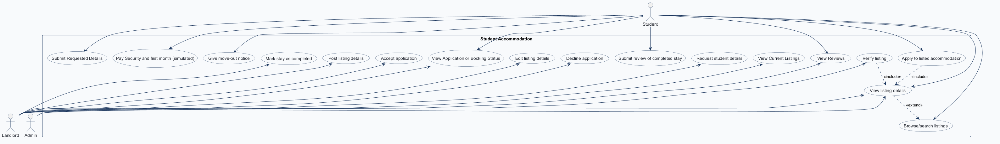
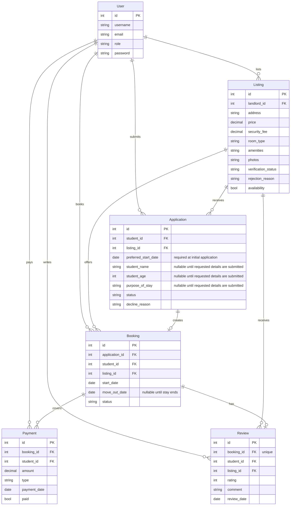
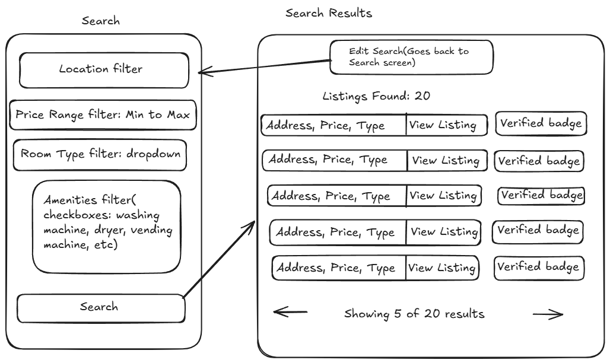
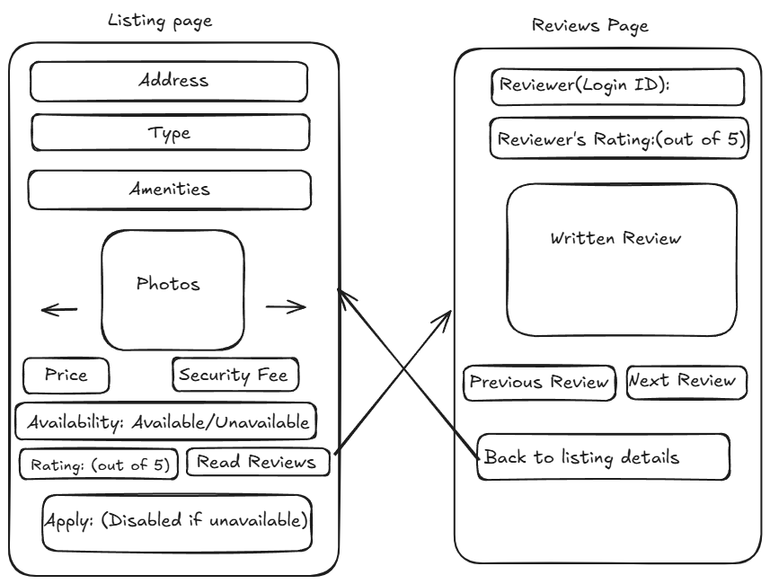
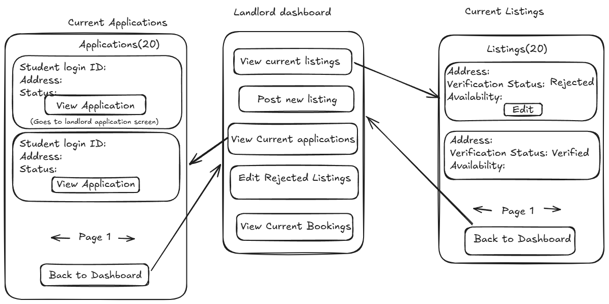
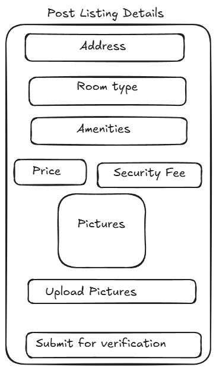
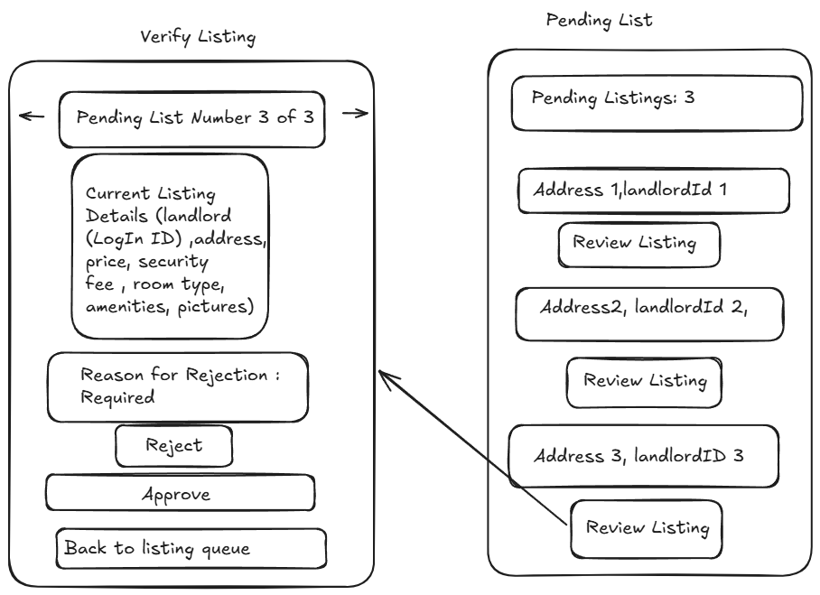
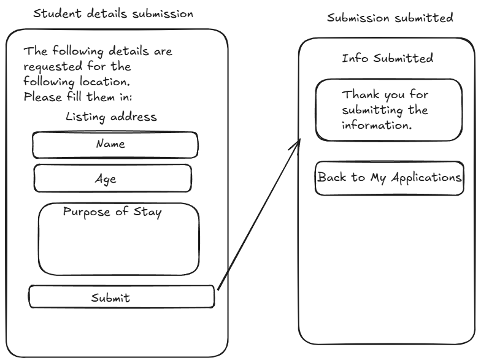
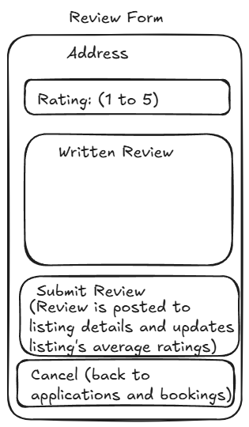
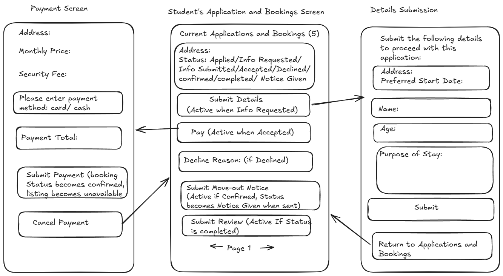

# COMP 3613 Assignment 1

Draft this file with the Guide. **Update it after every phase milestone** before you pause. The use-case diagram is a UML PNG at `docs/diagrams/use-case.png`, linked from this file as `diagrams/use-case.png` (path relative to `docs/report.md`). The model diagram is Mermaid. **Embed wireframe images** as `wireframes/<file>` (files live in `docs/wireframes/`).

Do not put your student ID in this file if you will commit it. The PDF cover adds your name and ID at export time.

## Assigned project

**Student Accommodation** — an Airbnb-like marketplace for finding nearby student accommodation: trusted listings, reviews, and tenant / booking management.

## Three workflows

### 1. Post listing detail for verification (Landlord)

### 2. Apply to listed accommodation (Student)

### 3. Submit review of completed stay (Student)

## Use case diagram

**Phase 2 notes.** Student is on the left; Landlord and Admin are on the right. **Post listing details** (Landlord) and **Verify listing** (Admin) are separate — no `«include»` between them. **Verify listing** and **Apply to listed accommodation** each `«include»` **View listing details**. **View listing details** `«extend»`s **Browse/search listings**. Extra Student use cases: Submit Requested Details, Pay Security and first month (simulated), Give move-out notice. Extra Landlord use cases: Edit listing details, Request student details, Accept application, Decline application, Mark stay as completed. **View Application or Booking Status** and **View Reviews** stay shared by Student and Landlord. Named workflows covered: Post listing detail for verification, Apply to listed accommodation, Submit review of completed stay.

**Phase 5 model/use-case refinement.** The landlord dashboard wireframe also covers **View Current Listings**, added to the use-case diagram as a Landlord use case. The post-listing success path now leads there.

**Implementation note.** **Edit listing details** was not built because rejected listings can instead be re-posted as a new listing submission.

## Model diagram

First draft. Update this section in Phase 5 when polish revises the model, and note what changed.

Assumption: `User` is the shared account entity for students and landlords, with `role` distinguishing the actor type. Relationships assume a listing can have many applications/bookings, one booking can produce one review, and each payment belongs to both its booking and student through foreign keys.

Phase 5 revision for **Apply to listed accommodation**: the student clarified that the initial application records the listing and required `preferred_start_date`; `student_name`, `student_age`, and `purpose_of_stay` are nullable until the landlord requests those details.

Phase 5 model revision for **Booking and Payment**: `Booking.application_id` is a unique foreign key to the accepted `Application`, so one accepted application creates one booking. `Payment` now records `booking_id` and `student_id` foreign keys, `amount`, `type`, `paid`, and `payment_date`.

Phase 5 model revision for **Submit review of completed stay**: `Review` records a unique `booking_id`, the reviewing `student_id`, the reviewed `listing_id`, a rating from 1 to 5, written `comment`, and `review_date`. Reviews are allowed only when the booking status is `Completed`, and one review is allowed per booking.

Workflow 3 booking lifecycle: the student can submit a move-out date only for a `Confirmed` booking, which changes its status to `Notice Given`. The landlord who owns the booking's listing can then mark it `Completed` only from `Notice Given`; completion makes the listing available again. The student and landlord pages show the booking status and expose only the action valid for that status. A review remains available only after completion.

Lifecycle correction: completing a booking now also changes its linked application to `Completed`. Completed applications remain visible in history but are excluded from active duplicate-application checks, so the student can apply to the listing again after the completed stay.

Final local verification for workflow 3: the student confirmed that a `Confirmed` booking can receive a move-out notice, the landlord can mark the resulting `Notice Given` booking as `Completed`, completion makes the listing available again, the linked application becomes `Completed`, completed applications no longer block a new application, and the student can submit a review only after completion.

Public listing review polish: `listing_detail_view` now loads reviews newest first and displays the reviewer's username as the login ID (the wireframe explicitly shows “Reviewer (Login ID)”), rating, written comment, and review date. It also displays the listing's average rating and “No reviews yet” when there are no reviews.

Review pagination polish: the public listing detail page now shows five reviews per page, newest first, with Previous/Next controls and a `Page X of Y` label. The average rating is calculated across every review for the listing, independent of the current page.

Local verification: the student confirmed that public listing review pagination works correctly, including five reviews per page, newest-first ordering, Previous/Next navigation, page labels, and an average rating calculated across all reviews. The reviewer login ID is rendered from `User.username`, so both seeded reviews display `bob` and `fred`, and reviews created through the app use the same lookup.

<!-- student-build:code-check
workflow: Submit review of completed stay (Student)
form: snippet
layer: model
architecture_ok: yes
implement_confidence: 0.72
passed: yes
note: Completed the Review SQLModel with unique booking link, student/listing foreign keys, rating, comment, and review_date.
-->

<!-- student-build:code-check
workflow: Submit review of completed stay (Student)
form: snippet
layer: router
architecture_ok: yes
implement_confidence: 0.72
passed: yes
note: Completed a thin review form route that calls ReviewService and redirects on expected validation errors.
-->

## Wireframes

### Browse / Search Listings

### View Listing Details / Reviews

### Landlord Dashboard / Current Listings

### Post Listing Details

### Verify Listing

### Apply to Listed Accommodation

### Submit Review of Completed Stay

### Booking and Payment Flow

<!-- student-build:wireframe-coverage
use_case: Post listing detail for verification
image: docs/wireframes/Post-Listing-details.png
covered: yes
-->

<!-- student-build:wireframe-coverage
use_case: View Current Listings
image: docs/wireframes/landlord-dashboard_current-listings-current-applications.png
covered: yes
-->

<!-- student-build:wireframe-coverage
use_case: Apply to listed accommodation
image: docs/wireframes/Student-details-submission.png
covered: yes
-->

<!-- student-build:wireframe-coverage
use_case: Submit review of completed stay
image: docs/wireframes/review-form.png
covered: yes
-->

<!-- student-build:wireframe-coverage
use_case: Browse / search listings
image: docs/wireframes/browse-search-listings.png
covered: yes
-->

<!-- student-build:wireframe-coverage
use_case: View listing details
image: docs/wireframes/View-Listing-Details_View-Reviews.png
covered: yes
-->

<!-- student-build:wireframe-coverage
use_case: Verify listing
image: docs/wireframes/Verify-listing.png
covered: yes
-->

Model note: the wireframes confirm the key metadata already represented in the draft model: `Listing.verification_status`, `Listing.security_fee`, `Listing.availability`, `Application.status`, `Booking.status`, `Payment.paid`, and `Review.rating` / `comment`.

## Theming

**Branding preferences:** professional, clean, and fun; purple primary with white secondary; Calibri; simple, friendly, modern tone; a cute dog sitting in a kennel as the logo.

**Applied:** brand tokens and Calibri system-font stack are in `app/static/css/app.css`. The landing, login, registration, session-expired page, and authenticated shell use the same purple-and-white styling. The original dog-in-a-kennel logo is `app/static/img/brand-dog-kennel.svg`. Generic starter home copy has been replaced with Student Accommodation copy; authentication and `/config` remain available.

## Implementation notes

One named workflow at a time. Include verify notes and polish / model revisions (Phase 5). Do not treat the first build as final.

### Workflow 1 — Post listing detail for verification (Landlord)

Local verification: the student reported that the post form and success message matched the wireframe, but success returned to a blank form with no status view. Submission was changed to redirect to Current Listings, showing address, verification status, and availability from the landlord’s own listings; the student confirmed these fields matched. The student then requested two listings per page, Previous/Next arrows, a page label, bordered cards, and a reserved space for a future Edit action on rejected listings. Server-side pagination returns two listings per page; the student confirmed pagination, borders, and card contents work. Rejected listings show the rejection reason to the landlord. The landlord re-posts a rejected listing as a new submission rather than editing the rejected row; this was chosen as the clearer reattempt workflow. The `Listing` SQLModel includes the ERD fields and a landlord foreign key; the student-completed POST route calls `ListingService` without persistence logic. Uploaded photo filenames are stored as a JSON list in the ERD's `photos` string field and files are saved under local `app/static/uploads/`. The demo photos are committed to the repository, so they are available on the deployed site. Photos uploaded through the live site are stored on the service's local disk and are temporary. Uploads are limited to five JPEG, PNG, WebP, or GIF images of 5 MB each. The default seed now includes the landlord account and demo data without an extra flag; login: `landlord` / `landlordpass`.

<!-- student-build:code-check
workflow: Post listing detail for verification (Landlord)
form: choice
layer: other
architecture_ok: yes
implement_confidence: 0.87
passed: yes
note: Chose local image uploads and a five-image, 5 MB per-image limit.
-->

<!-- student-build:code-check
workflow: Post listing detail for verification (Landlord)
form: mcq
layer: service
architecture_ok: yes
implement_confidence: 0.87
passed: yes
note: Correctly placed coordination of listing submission requirements in the service.
-->

<!-- student-build:code-check
workflow: Post listing detail for verification (Landlord)
form: choice
layer: other
architecture_ok: yes
implement_confidence: 0.87
passed: yes
note: Chose separately provisioned landlord accounts rather than changing public sign-up.
-->

<!-- student-build:code-check
workflow: Post listing detail for verification (Landlord)
form: choice
layer: other
architecture_ok: yes
implement_confidence: 0.87
passed: yes
note: Chose an opt-in CLI seed account for local testing.
-->

<!-- student-build:code-check
workflow: Post listing detail for verification (Landlord)
form: snippet
layer: model
architecture_ok: yes
implement_confidence: 0.87
passed: yes
note: Added the ERD listing fields, pending/available defaults, and landlord foreign key.
-->

<!-- student-build:code-check
workflow: Post listing detail for verification (Landlord)
form: snippet
layer: router
architecture_ok: yes
implement_confidence: 0.87
passed: yes
note: Route binds form inputs and calls ListingService; no persistence logic in router.
-->

### Workflow 2 — Apply to listed accommodation (Student)

The student chose to apply only to listings marked `Verified`; unavailable listings remain viewable but cannot be applied to. The initial application stores the listing, student, and preferred start date; name, age, and purpose remain nullable until the landlord requests those details. A student may retry after a `Declined` application; the declined attempt remains in history and a fresh application is created. An active duplicate is blocked. Browse/search filters verified listings by location/address, price range, room type, and the wireframe’s amenity options; results show five per page. Application confirmation leads to My Applications. Repository queries own all listing/application persistence; service coordinates eligibility and duplicate checks.

Code-check correction: the first student service attempt compared the status against lowercase `verified`, which would reject actual `Verified` rows. The student corrected it to the exact capitalized listing status and added student-role/ID checks.

Implementation is wired through search, verified listing detail/photo gallery, date-only Apply, and paginated My Applications. Local verification: the student approved a listing through the admin screen, confirmed it became visible to students, and confirmed a student could view its details and apply with a start date. The student also confirmed a rejection cannot be submitted without a reason.

The student clarified that this workflow still includes landlord review: landlords view applications and request the deferred student details; students submit requested details; landlords accept or decline; accepted applications proceed through simulated payment, and accepting an application creates its Booking. This is now wired on the student side with an `Info Requested` details form on My Applications that calls the thin POST route and `ApplicationService.submit_requested_details`. Landlords may decline an `Applied` application before requesting details; the wireframe requires a decline reason. The wireframe's application status labels are `Applied`, `Info Requested`, `Info Submitted`, `Accepted`, and `Declined`. Booking has an application FK (unique), student FK, listing FK, required start date, optional move-out date, and status. Finish these parts before starting the separate review workflow. Do not build the Review screen or Booking browsing/management pages yet.

The landlord review portion is now wired into Current Listings. Each landlord listing displays its applications, supports requesting student details, and provides accept/decline controls. These actions call `ApplicationService` through thin routes; the student tested the flow successfully, including the expected status changes and decline validation.

For the remaining booking/payment portion of this workflow, the student chose a separate booking/payment page linked from the Applications and Bookings screen, matching `docs/wireframes/Apps-and-Books_Payment_Details-submission.png`.

The student completed the Payment SQLModel fields and the booking payment route snippet. The payment model uses `payment_date` (not a generic `date`) and links each payment to its booking and student. The booking model retains the unique `application_id` foreign key.

<!-- student-build:code-check
workflow: Apply to listed accommodation (Student)
form: snippet
layer: model
architecture_ok: yes
implement_confidence: 0.72
passed: yes
note: Completed Payment with booking/student foreign keys, amount, type, paid, and payment_date; Booking retains a unique application_id foreign key.
-->

<!-- student-build:code-check
workflow: Apply to listed accommodation (Student)
form: snippet
layer: router
architecture_ok: yes
implement_confidence: 0.72
passed: yes
note: Completed the booking payment view route to call BookingService without persistence logic.
-->

The student chose to create a Booking with status `Awaiting Payment` when an application is accepted and added `Booking.application_id` so one accepted application maps to one booking. Only the student on that booking may pay, and payment is allowed only while the booking is `Awaiting Payment`. The simulated payment amount is the listing security fee plus its first month's rent; successful payment changes the booking to `Confirmed` and makes the listing unavailable. If multiple students have active applications, the landlord decides each individually; accepting must be refused if the listing is unavailable or a booking is already in progress.

Final local verification for this workflow: the student confirmed that payment makes the listing unavailable, changes the student's application display to the linked booking status `Confirmed`, and removes the payment link. The landlord Current Listings page also shows `Awaiting Payment` after acceptance and `Confirmed` after payment. Listing, security-fee, and payment totals are formatted to two decimal places throughout the relevant screens. Workflow 2 is complete; workflow 3 has not started.

Input validation polish: listing price and security fee fields now use decimal-only browser inputs and server-side validation that rejects exponents, signs, multiple decimal points, and other non-numeric characters. Student age uses digits-only browser input and server-side validation.

Workflow 3 start: the student chose to allow one review per booking, only after the linked booking status is `Completed`.

<!-- student-build:code-check
workflow: Apply to listed accommodation (Student)
form: choice
layer: other
architecture_ok: yes
implement_confidence: 0.68
passed: yes
note: Final choice: preferred start date at initial Apply; name, age, and purpose are collected only after a landlord request.
-->

<!-- student-build:code-check
workflow: Apply to listed accommodation (Student)
form: choice
layer: service
architecture_ok: yes
implement_confidence: 0.68
passed: yes
note: Limited student search to listings marked Verified; availability remains separately displayed.
-->

<!-- student-build:code-check
workflow: Apply to listed accommodation (Student)
form: choice
layer: other
architecture_ok: yes
implement_confidence: 0.68
passed: yes
note: Blocks repeat active applications; permits a retry after Declined and preserves the earlier row.
-->

<!-- student-build:code-check
workflow: Apply to listed accommodation (Student)
form: mcq
layer: service
architecture_ok: yes
implement_confidence: 0.68
passed: yes
note: Correctly placed application eligibility and duplicate decisions in the service.
-->

<!-- student-build:code-check
workflow: Apply to listed accommodation (Student)
form: snippet
layer: model
architecture_ok: yes
implement_confidence: 0.68
passed: yes
note: Added Application foreign keys and nullable requested-detail fields to match the revised ERD.
-->

<!-- student-build:code-check
workflow: Apply to listed accommodation (Student)
form: snippet
layer: service
architecture_ok: yes
implement_confidence: 0.68
passed: no
note: First pass used lowercase verified and omitted student account checks; student revised after pointing out exact status values.
-->

<!-- student-build:code-check
workflow: Apply to listed accommodation (Student)
form: snippet
layer: service
architecture_ok: yes
implement_confidence: 0.68
passed: yes
note: Corrected exact Verified status, role/ID checks, availability, own-listing rejection, and active-duplicate behavior.
-->

<!-- student-build:code-check
workflow: Apply to listed accommodation (Student)
form: snippet
layer: repository
architecture_ok: yes
implement_confidence: 0.68
passed: yes
note: Added paginated My Applications query in the repository and used repository lookup methods from the service.
-->

<!-- student-build:code-check
workflow: Apply to listed accommodation (Student)
form: snippet
layer: router
architecture_ok: yes
implement_confidence: 0.68
passed: yes
note: Thin POST handler binds listing/date, calls ApplicationService, catches expected ValueError, and redirects without SQL.
-->

<!-- student-build:code-check
workflow: Apply to listed accommodation (Student)
form: choice
layer: model
architecture_ok: yes
implement_confidence: 0.72
passed: yes
note: Chose a unique Booking.application_id FK to link one accepted application to its booking and revised the ERD.
-->

<!-- student-build:code-check
workflow: Apply to listed accommodation (Student)
form: snippet
layer: model
architecture_ok: yes
implement_confidence: 0.72
passed: yes
note: Added Booking fields matching the ERD, including unique Application link, student/listing links, dates, and Awaiting Payment status.
-->

<!-- student-build:code-check
workflow: Apply to listed accommodation (Student)
form: choice
layer: other
architecture_ok: yes
implement_confidence: 0.72
passed: yes
note: Chose to allow landlords to decline an Applied application before requesting details.
-->

<!-- student-build:code-check
workflow: Apply to listed accommodation (Student)
form: snippet
layer: repository
architecture_ok: yes
implement_confidence: 0.72
passed: yes
note: Joined applications to listings to retrieve only this landlord's applications, with pagination and newest-first ordering.
-->

<!-- student-build:code-check
workflow: Apply to listed accommodation (Student)
form: snippet
layer: service
architecture_ok: yes
implement_confidence: 0.72
passed: yes
note: Enforces landlord role, listing ownership, and Applied status before requesting further details, then updates application status.
-->

<!-- student-build:code-check
workflow: Apply to listed accommodation (Student)
form: choice
layer: other
architecture_ok: yes
implement_confidence: 0.72
passed: yes
note: Booking starts Awaiting Payment, only its student can pay; payment is security fee plus first-month rent.
-->

<!-- student-build:code-check
workflow: Apply to listed accommodation (Student)
form: choice
layer: service
architecture_ok: yes
implement_confidence: 0.72
passed: yes
note: Decided that Awaiting Payment, Confirmed, and Notice Given block another acceptance for the listing.
-->

<!-- student-build:code-check
workflow: Apply to listed accommodation (Student)
form: snippet
layer: service
architecture_ok: yes
implement_confidence: 0.72
passed: yes
note: Allows decline from Applied, Info Requested, or Info Submitted with a required reason; acceptance requires Info Submitted and an available listing with no in-progress booking.
-->

<!-- student-build:code-check
workflow: Apply to listed accommodation (Student)
form: snippet
layer: service
architecture_ok: yes
implement_confidence: 0.72
passed: yes
note: Validates student ownership and Info Requested state, validates required details, persists them, and transitions to Info Submitted.
-->

### Additional Phase 5 workflow — Verify listing (Admin)

The admin review flow follows `docs/wireframes/Verify-listing.png`, which sketches a pending queue and a listing-review surface with landlord ID, address, price, security fee, room type, amenities, photos, previous/next navigation, rejection reason, Reject, and Approve. Per the student's implementation request, listing details and decision forms are shown directly on each paginated queue card rather than adding a separate review screen. The rejection reason is required for rejection. Approval sets the listing to `Verified`; rejection sets it to `Rejected` with the reason. The student chose to return to the pending queue after either decision. This provides an in-app verified listing for the Apply workflow test.

The student named the queue route `admin_pending_listings_view` at `/admin/listings/pending`. The implemented queue shows pending listing details with landlord login name/ID, individual Approve and Reject forms, a required reason field for rejection, five listings per page, and a newest/oldest selector. Ordering uses listing ID as the creation-order proxy because the ERD has no creation timestamp. Admin decisions are restricted to the `admin` role, and the service requires the listing to exist and still be `Pending`. `Listing.verification_status` is limited to eight characters to fit the exact statuses `Pending`, `Verified`, and `Rejected`.

Local verification: the student reports approving a listing and seeing it available to the student flow; an empty rejection reason is blocked; after rejecting a listing with a reason, the landlord could see that reason in Current Listings; and the pending queue's ordering and pagination both work.

<!-- student-build:code-check
workflow: Verify listing (Admin)
form: choice
layer: other
architecture_ok: yes
implement_confidence: 0.79
passed: yes
note: Chose to return to the pending queue after approving or rejecting a listing.
-->

<!-- student-build:code-check
workflow: Verify listing (Admin)
form: mcq
layer: service
architecture_ok: yes
implement_confidence: 0.79
passed: yes
note: Correctly identified the Service as the layer to coordinate an admin's listing decision.
-->

<!-- student-build:code-check
workflow: Verify listing (Admin)
form: snippet
layer: model
architecture_ok: yes
implement_confidence: 0.79
passed: yes
note: Constrained Listing.verification_status to fit the exact Pending, Verified, and Rejected values.
-->

<!-- student-build:code-check
workflow: Verify listing (Admin)
form: snippet
layer: repository
architecture_ok: yes
implement_confidence: 0.74
passed: yes
note: Implemented pending-only lookup with count, Pagination, and newest/oldest ID ordering.
-->

<!-- student-judge:sincerity
round: 1
questions_asked: 2
flags: polished, assistant-like implementation instruction block with a route-name clarification
sincerity_confidence: 0.80
trend: up
note: Student explained route/service/repository responsibilities in their own words and named the pending-queue route as requested.
-->

<!-- student-build:code-check
workflow: Verify listing (Admin)
form: snippet
layer: router
architecture_ok: yes
implement_confidence: 0.74
passed: yes
note: Completed a thin decision route that calls ListingService, flashes success or validation errors, and redirects using the chosen queue route name.
-->

## Deployed app

Phase 6. Public Render URL (not localhost). Markers open this to mark the three workflows.

https://comp3613a1-student-accomodation.onrender.com/

The Render Postgres database and web service were created in the Render dashboard using the settings from `README.md`, because the Render MCP tools were not exposed to the chat.

## Logins

Every account a marker needs, including extra users you added. Starter accounts:

- bob / bobpass — student
- fred / fredpass — student
- landlord / landlordpass — landlord
- admin / adminpass — admin

The default seed data contains four accounts, five Verified listings, one Pending listing, two completed stays, and two reviews. The completed-stay listing remains available so students can apply.

## YouTube URL

https://youtu.be/nmQLianR1UA

## Repository and agents

GitHub repository: https://github.com/StephanHolder/COMP3613A1-student-accomodation

Agents used: GitHub Copilot Agent in VS Code and Cursor Hobby.

## Session transcripts

Filled when the Guide builds the report: the agent writes each Guide chat to `docs/transcripts/<slug>.md` (Copilot Agent, Cursor, or OpenCode). `python manage.py report` packages them. Do not paste chats here during the build.

## Competency (student-judge)

Filled when the report is built. Guide runs student-judge, writes `docs/judge.md`, and export appends the scorecard here.

## Skill integrity

Filled by `python manage.py report`. Do not edit the course skills.
